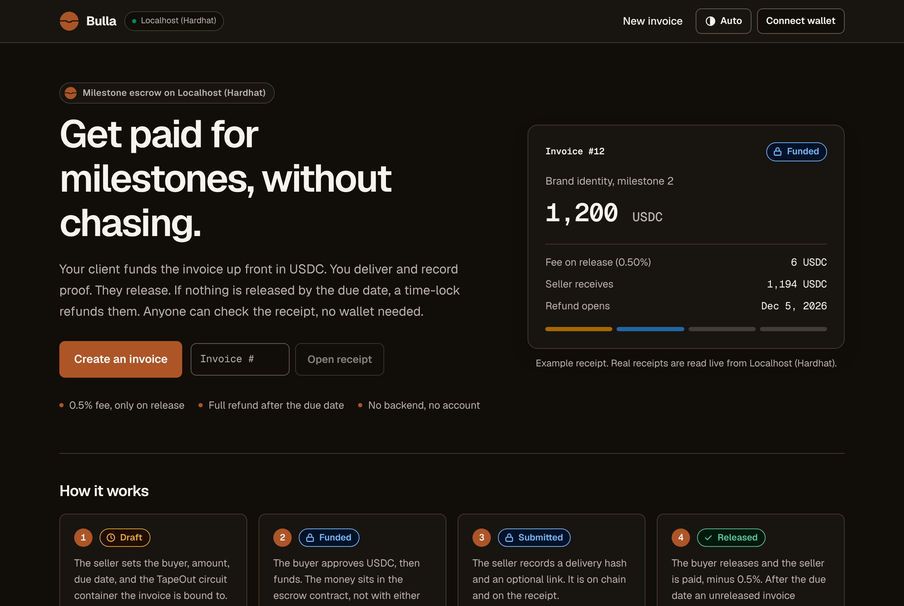
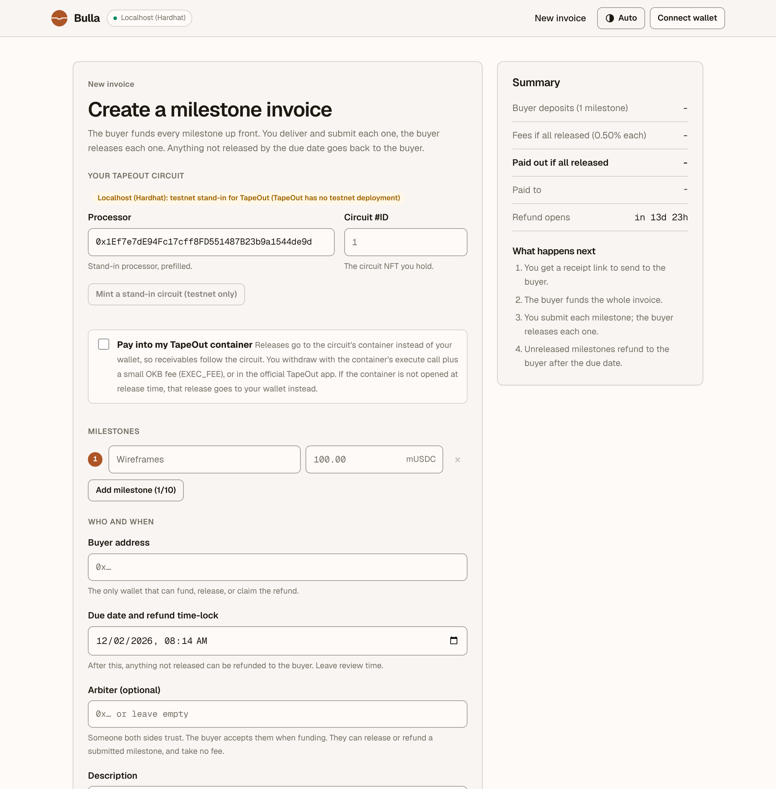
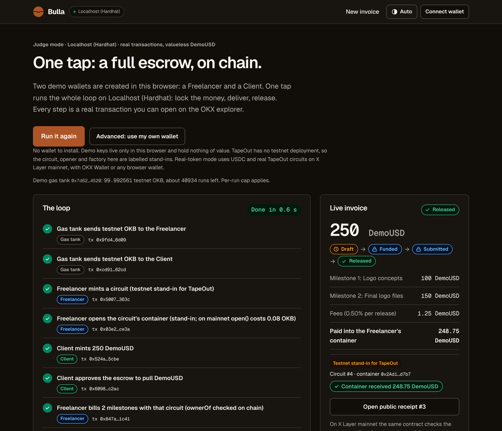

<p align="center"></p>

# Bulla

Milestone invoices with on-chain escrow on X Layer. A freelancer creates an invoice, the client funds it, the freelancer submits a delivery hash or link, and the client approves the release, or a published time-lock refunds the client. Flow: Draft → Funded → Submitted → Released / Refunded, plus a two-consent mutual cancel.

A TapeOut circuit container is the escrow identity and the DeWEB home of the app; a companion contract holds funds and state. Every invoice has a public receipt link that needs no wallet.

> **Warnings.** Bulla v1 is **unaudited**. **Whoever holds the TapeOut circuit controls its container. This is not safe if that wallet is stolen.** Funds follow the escrow contract rules (seller and buyer addresses), not the circuit.

Built for the X Layer TapeOut Accelerate hackathon (deadline 7 Dec 2026, 23:59 UTC).

*A bulla was a sealed Mesopotamian clay envelope holding tokens for goods owed, broken open only when the deal completed.*

## Status

| Piece | State |
| --- | --- |
| `BullaEscrow` contract | done; 47 Hardhat tests incl. seeded fuzz + invariant walks; Slither 0 high / 0 medium |
| Judge mode ("Try it now": one-tap lock, submit, release on X Layer testnet with burner keys) | done; local acceptance 0.4 s in-app (limit 10 s); testnet deploy + gas tank pending (human / Grok Bot) |
| Web app (landing, create, no-wallet receipt with QR, all actions) | done; static relative-path build, light and dark, 375px to desktop |
| E2E (happy path, timeout refund, mutual cancel, revert toast, 375px + keyboard, judge mode) | 9 passing on a local Hardhat node; `npm run e2e:testnet` opt-in |
| X Layer testnet / mainnet deploy | scripts ready, **not deployed** (needs a human key) |
| TapeOut circuit + container | **not minted** (human, official UI) |
| DeWEB publish | package ready (~465 KB, 12 files), **not published** |

Everything still open is listed in [`docs/HANDOFF.md`](docs/HANDOFF.md). `npm run release:check` fails until it is done.

## Screenshots

Generated from a real local chain with `npm run screenshots` (light and dark, desktop and 375px):

| Light | Dark |
| --- | --- |
|  |  |
|  |  |
|  |  |
|  |  |

Mobile: [landing](docs/screenshots/mobile-landing-light.png), [receipt](docs/screenshots/mobile-receipt-light.png), [receipt dark](docs/screenshots/mobile-receipt-dark.png). Released receipt: [light](docs/screenshots/receipt-released-light.png), [dark](docs/screenshots/receipt-released-dark.png).

## Architecture

```
 seller / buyer wallets (OKX Wallet, MetaMask, any injected)
            │  createInvoice / fund / submit / release / refund / cancel
            ▼
 BullaEscrow (X Layer) ── holds USDC + invoice state, 0.5% fee on release only
            │  each invoice stores circuitContainerId (bytes32)
            ▼
 TapeOut circuit container (ERC-6551 account of the seller's circuit NFT)
            │  hosts the static Bulla app in SiteRegistry (DeWEB)
            ▼
 Anyone: open https://tapekit.org/ (gateway) → #/invoice/<id> receipt, no wallet
```

No backend. No TapeSend. No bridges. The contract never calls TapeOut; the container id is a binding and a pointer (`docs/contracts.md`).

## Repo layout

```
contracts/   Hardhat project: BullaEscrow.sol, MockERC20, tests, deploy scripts, deployments.json
web/         Vite + React + TypeScript + wagmi/viem static app
scripts/     probes, deweb-package, e2e runner + local stack, screenshots, release:check, check:contrast, ABI export
shared/      framework-free TS used by web and tests: JSON-RPC helpers, TapeOut name resolver, deployments schema
e2e/         Playwright specs and the injected test wallet
docs/        research, contracts, TapeOut binding, DeWEB, submission draft, demo script, handoff
assets/      logo-clay.png (brand mark), logo.png (monochrome original)
```

## Install, test, run, build

Requires Node 20+ (tested on Node 22). The Solidity compiler comes from the `solc` npm package, so nothing is downloaded from binaries.soliditylang.org.

```bash
npm install                 # all workspaces
npm run compile             # contracts
npm test                    # 47 contract tests (unit, fuzz/invariant, TapeOut resolver, deploy wiring)
npm run build               # web → web/dist (relative paths)
```

Local app against a local chain:

```bash
npm run node                                  # terminal 1: Hardhat node on :8545
npm run deploy:local                          # terminal 2: MockERC20 + BullaEscrow + a fixture invoice → contracts/deployments.json
VITE_BULLA_NETWORK=localhost npm run dev      # http://localhost:5173/#/invoice/1 (no wallet needed)
```

UI-only preview with fixture data and no chain: `VITE_MOCK=1 VITE_BULLA_NETWORK=localhost npm run dev`. Never publish a mock build.

End-to-end (hermetic: own node on :8546, random throwaway keys in gitignored `e2e/.keys.json`, no faucet):

```bash
npx playwright install chromium   # once, if your machine has no Playwright browser
npm run e2e                       # prints [e2e] RESULT: PASS / FAIL
```

DeWEB package: `npm run deweb:package` → `deweb-out/` (see `docs/deweb.md`).

Probes (read-only): `npm run probe:network`, `npm run probe:tapeout`.

Judge mode locally: `npm run e2e` includes `e2e/judge-mode.spec.ts`. Against X Layer testnet: `npm run deploy:judge` (needs a testnet key), then `E2E_TESTNET=1 VITE_DEMO_GAS_TANK_KEY=… npm run e2e:testnet` (skips cleanly without them). Build the hosted judge site with `VITE_BULLA_NETWORK=xlayerTestnet VITE_DEMO_GAS_TANK_KEY=… npm run build`; the tank key ends up in that build, so it must be a throwaway, faucet-funded, testnet-only key.

Other checks: `npm run check:contrast` (theme pairings, both modes), `npm run screenshots` (regenerates `docs/screenshots/`), `npm run release:check` (fails while any placeholder, undeployed mainnet escrow, or unpublished DeWEB field remains). Larger fuzz campaign: `FUZZ_RUNS=20 FUZZ_STEPS=300 npx hardhat test test/BullaEscrow.invariants.test.ts` (from `contracts/`).

Theme: colors, fonts and status hues follow [`docs/design/color-theme.md`](docs/design/color-theme.md) (tokens in `web/src/styles.css`, light, dark via `prefers-color-scheme`, and a manual Auto/Light/Dark toggle). `npm run check:contrast` verifies every pairing the UI uses against the theme targets.

## Environment variables

Copy `.env.example` to `.env` (gitignored). Never commit keys.

| Variable | Used by | Notes |
| --- | --- | --- |
| `X_LAYER_RPC` | probes | e.g. `https://rpc.xlayer.tech` |
| `X_LAYER_CHAIN_ID` | probe-network | 196 mainnet, 1952 testnet; asserted if set |
| `EXPLORER_URL` | docs/reference | `https://www.okx.com/web3/explorer/xlayer` |
| `ESCROW_TOKEN` | probes, deploy | optional until the mainnet token gate passes |
| `ESCROW_ADDRESS` | probe-network | empty until deployed |
| `FEE_RECIPIENT`, `FEE_BPS` | deploy | `FEE_BPS` default 50 |
| `DEPLOYER_PRIVATE_KEY` | deploy | **a human supplies it locally**; scripts dry-run without it |
| `CONFIRM_MAINNET` | mainnet deploy | must be `I_UNDERSTAND_UNAUDITED` |
| `TAPEOUT_PROCESSOR`, `TAPEOUT_CIRCUIT_ID` | probe-tapeout | your circuit |
| `VITE_BULLA_NETWORK` | web build | `localhost`, `xlayerTestnet`, `xlayerMainnet` (default) |
| `VITE_ESCROW_ADDRESS`, `VITE_ESCROW_TOKEN`, `VITE_RPC_URL` | web build | override `contracts/deployments.json` |
| `VITE_DEPLOY_BLOCK` | web build | override the block the receipt timeline scans logs from |
| `VITE_DEMO_GAS_TANK_KEY` | judge build only | **testnet-only** throwaway gas-tank key; embedded in the judge build; mainnet builds refuse it |
| `VITE_JUDGE_URL` | mainnet build | link "Try it now" to the hosted testnet judge build |
| `VITE_JUDGE_ESCROW_ADDRESS`, `VITE_JUDGE_TOKEN`, `VITE_JUDGE_DEPLOY_BLOCK` | judge build | override `deployments.json` `xlayerTestnet.judge` |
| `VITE_MOCK` | web build | `1` = dev fixtures only |

Network facts (chain IDs, RPCs, explorers, USDC addresses, TapeOut contracts) and their sources are in `docs/research.md`.

## Deploying (human)

```bash
# testnet (chain 1952)
ESCROW_TOKEN=0xDec90b78111Ba2fc6FC6d84d8B9ec159A2d4b9B3 FEE_RECIPIENT=0x... npm run deploy:testnet
# mainnet (chain 196), only after the token gate in docs/research.md
ESCROW_TOKEN=0xB6CEceAB302E2E4948951eE7843FC24E92933061 FEE_RECIPIENT=0x... CONFIRM_MAINNET=I_UNDERSTAND_UNAUDITED npm run deploy:mainnet
```

Without `DEPLOYER_PRIVATE_KEY` in `.env` both print a dry-run plan and exit non-zero. They never invent an address. On success they write `contracts/deployments.json` in the schema the web app reads (`shared/deployments.ts`), so the UI only needs `npm run build` / `npm run deweb:package` afterwards.

## How Bulla uses X Layer

X Layer is the core loop: every lock, delivery and release is an X Layer transaction. Each row is wired in this repo today; "status" says what still needs a human (see `docs/HANDOFF.md`). Sources are in `docs/research.md` §1 to §3 and §7.

| # | X Layer / OKX feature | What is wired | Where | Status |
| --- | --- | --- | --- | --- |
| 1 | **X Layer settlement** (mainnet 196, testnet 1952) | `BullaEscrow` holds funds and state on X Layer; the app reads every receipt straight from an X Layer RPC; the judge-mode loop runs on testnet 1952 | `contracts/`, `web/src/config.ts`, `web/src/judge/` | Code and deploy scripts done; testnet and mainnet deploys pending (human) |
| 2 | **OKX Wallet** as the first-class wallet | Listed first and marked "Recommended on X Layer"; adds or switches to the X Layer network; "Get OKX Wallet" link when not installed; any other injected wallet still works | `web/src/lib/wallet.tsx`, `web/src/components/Wallet.tsx` | Done (official provider-name doc not found; see research §7) |
| 3 | **OKX explorer deep links** on every tx | Toasts, the receipt timeline, every judge-mode step and every address link open the OKX X Layer explorer | `web/src/config.ts` (`explorerTx`, `explorerAddress`), `web/src/judge/JudgePage.tsx` | Done; mainnet `/tx/` path confirmed, testnet path to confirm on first click |
| 4 | **Native USDC on X Layer** for real mode | Real-token escrow is bound to Circle's X Layer USDC (`0xB6Ce…3061`, 6 decimals probed); judge mode uses valueless DemoUSD instead | `contracts/deployments.json`, `contracts/scripts/deploy-xlayer.ts` | Token confirmed; escrow deploy pending |
| 5 | **TapeOut circuit, container and DeWEB hosting** | Every invoice stores the seller's TapeOut container; mainnet receipts show the seller's `<#ID>.2.<cpu>.tape` name; the app is packaged for the container's SiteRegistry site | `contracts/contracts/BullaEscrow.sol`, `shared/tapeoutCore.ts`, `scripts/deweb-package.ts` | Wired; circuit mint and DeWEB publish pending (human) |

How this maps to the official judging criteria:

- **User value and commercial potential.** Late payment is a common freelancer problem (approved citations in `docs/SUBMISSION-DRAFT.md`). Settlement in native USDC on X Layer (rows 1, 4) means the client funds up front and the freelancer is paid on release; Bulla earns 0.5% only on successful releases.
- **Innovation.** The escrow's identity and its public receipt live in the seller's TapeOut container on DeWEB (row 5), not on a server; judge mode shows a full escrow loop with no wallet setup, in one tap (row 1).
- **Ecosystem integration.** Five X Layer and OKX pieces are used together: X Layer settlement, OKX Wallet, the OKX explorer, native USDC, and TapeOut container plus DeWEB (rows 1 to 5).
- **Product readiness and UX.** One tap from the landing page runs lock, deliver and release on X Layer testnet, with an OKX explorer link per step; the local acceptance test does it in under a second (limit 10 s). Receipts need no wallet; real mode uses OKX Wallet (rows 2, 3).

## How Bulla differs from TapeFlow and CoTape

- **TapeFlow** is a general TapeOut payment UI. Bulla is one narrow workflow: a freelancer milestone invoice with a time-locked escrow and a public, wallet-free receipt.
- **CoTape** matches circuit designers and funders on the Behemoth line with miner-contract escrow and revenue split. Bulla has nothing to do with miners or tape-out funding; its users are freelancers and their clients paying for ordinary work in USDC.
- Bulla is not a token launch, not a miner desk, and not a site generator.

## Which TapeOut features Bulla uses

- **Circuit container as identity:** every invoice stores the seller's TapeOut container id; the receipt links it.
- **DeWEB / SiteRegistry:** the app is a static build packaged for the container's on-chain site store, opened by laypeople through the TapeKit gateway.
- **TapeOut read APIs:** receipts on X Layer mainnet show the seller's `<#ID>.2.<cpu>.tape` name, resolved from `container.token()`, `factory.isCPU/cpuCount/cpuAt` and `opener.accountOf` (hidden if any check disagrees). `probe:tapeout` reads factory, opener, SiteRegistry and DomainBinding to derive and check the container id.

Details and status: `docs/tapeout-binding.md`.

## Docs

- [`docs/research.md`](docs/research.md): verified chain, token, and TapeOut facts with sources and UNKNOWNs
- [`docs/contracts.md`](docs/contracts.md): states, callers, fee math, accounting, safety properties, fuzz/invariant tests
- [`docs/slither.md`](docs/slither.md): static analysis runs
- [`docs/tapeout-binding.md`](docs/tapeout-binding.md): getting a real circuit container id
- [`docs/deweb.md`](docs/deweb.md): DeWEB packaging, publishing, HTTPS fallback
- [`docs/SUBMISSION-DRAFT.md`](docs/SUBMISSION-DRAFT.md): form answers with placeholders
- [`docs/DEMO.md`](docs/DEMO.md): demo video script (≤ 3 min), opens on a live judge-mode release
- [`docs/SUBMISSION-CHECKLIST.md`](docs/SUBMISSION-CHECKLIST.md): owners and due dates up to 6 Dec 2026
- [`docs/HANDOFF.md`](docs/HANDOFF.md): what is not done and what "done" looks like

## Planning docs

- `docs/planning/verdict.md`, `competition.md`, `research.md`: idea selection and earlier research (leads, not authority)
- `docs/planning/claude-code-prompts.md`, `docs/handoff/phase-1.md`: phased build prompts
- `docs/planning/non-claude-tasks.md`, `docs/planning/endgame/`: human-only wallet, deploy, and submission tasks
- `docs/planning/fanout/`: research fan-out transcripts
