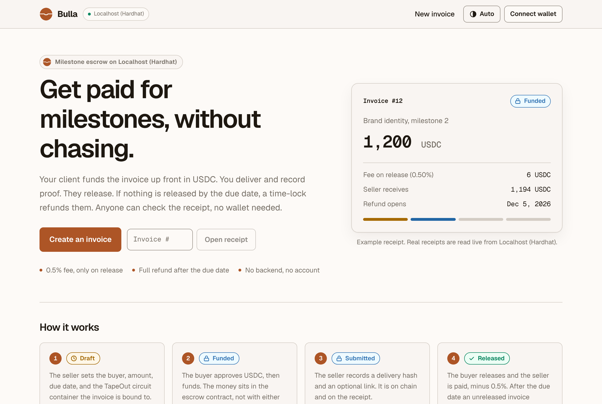
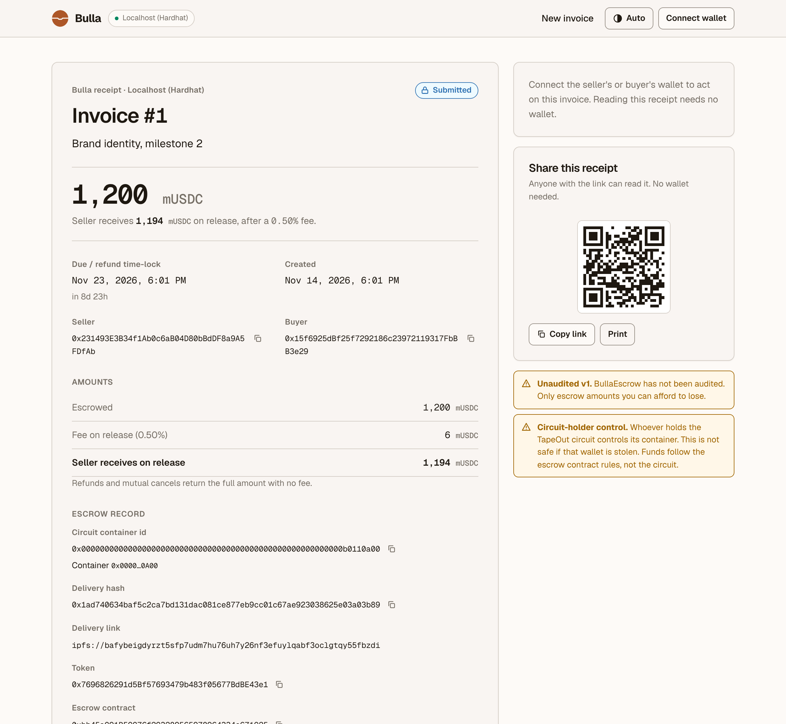
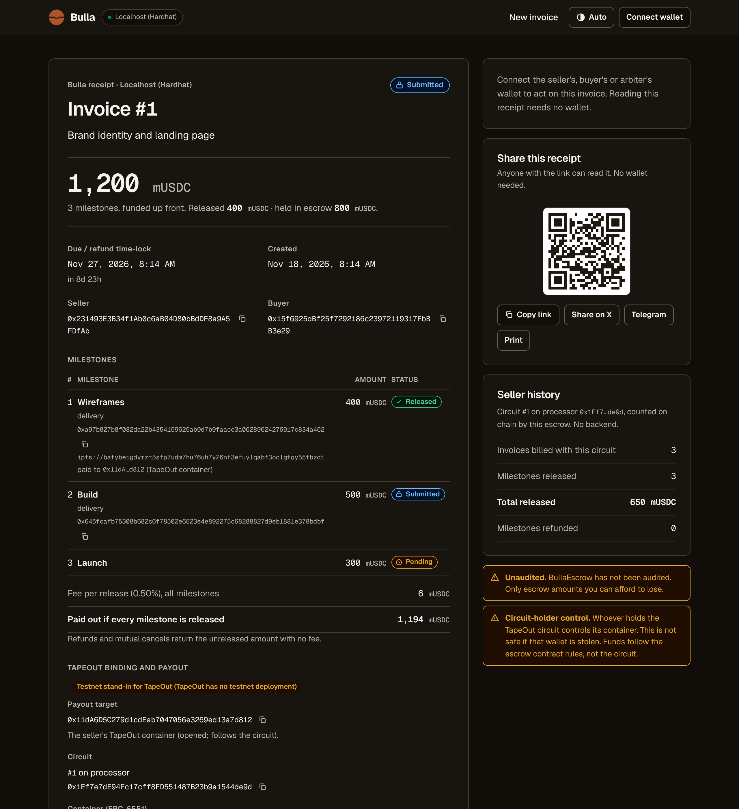
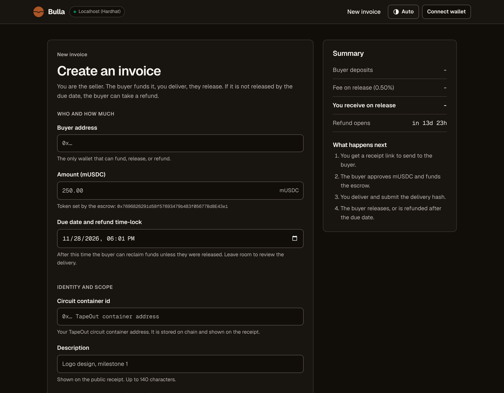
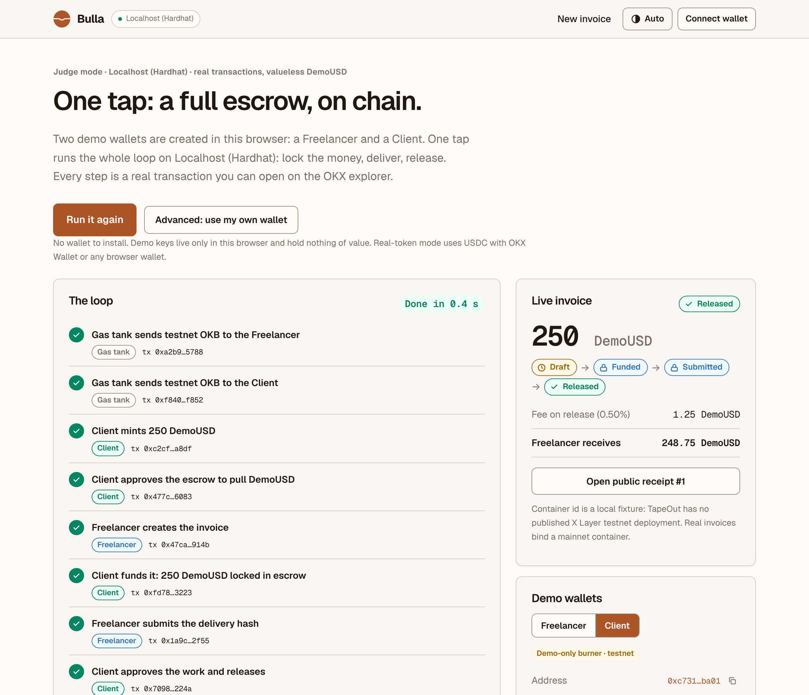

<p align="center"></p>

# Bulla

Milestone escrow where your TapeOut circuit is your business account. A freelancer bills 1 to 10 milestones with a TapeOut circuit they hold (checked on chain with `ownerOf`), the client funds every milestone up front in USDC on X Layer, the freelancer submits each delivery, and the client releases each milestone, which pays the circuit's holder or, if the freelancer opts in, the circuit's container. Anything unreleased by the due date refunds the client. An optional arbiter, accepted by the client, can settle a submitted milestone. Every invoice has a public receipt that needs no wallet.

> **Warnings.** Bulla v2 is **unaudited**. **Whoever holds the TapeOut circuit controls its container and receives future releases. This is not safe if that wallet is stolen.** Paying into the container is opt-in: a container must be opened first (`open()`, 0.08 OKB), releases to an unopened one fall back to the holder, and withdrawing needs the holder to call `execute` with `EXEC_FEE()` attached (`docs/research.md` §9).

Built for the X Layer TapeOut Accelerate hackathon (deadline 7 Dec 2026, 23:59 UTC).

*A bulla was a sealed Mesopotamian clay envelope holding tokens for goods owed, broken open only when the deal completed.*

## Status

| Piece | State |
| --- | --- |
| `BullaEscrow` v2 (circuit-bound, 1 to 10 milestones, optional arbiter, container payout) | done; 57 Hardhat tests incl. seeded fuzz + invariant walks; Slither 0 high / 0 medium |
| Judge mode ("Try it now": one tap, two milestones paid into a stand-in container on X Layer testnet) | done; local acceptance 12 txs in 0.7 s in-app (664 ms), 1.0 s tap to Released (982 ms) (limit 10 s); testnet deploy + gas tank pending (Grok Bot) |
| Web app (landing, create with circuit check and milestones, receipt with on-chain activity panel and share kit) | done; static relative-path build, light and dark, 375px to desktop |
| E2E (happy path, timeout refund, mutual cancel, revert toast, two milestones + container + arbiter, 375px + keyboard, judge mode) | 10 passing on a local Hardhat node; `npm run e2e:testnet` opt-in |
| X Layer testnet / mainnet deploy | v2 deployed: mainnet `0x35a7862e64b60857aDd42a8B8621DB8d9b4B5E07` (Sourcify exact match), testnet `0xCb72D2798139C6Bb6e6c715E6F98c83D7DC39Ea6`, judge `0x6ed736ce42582a749e52fe4B95d17d95Ccc4e9b4`; a superseded v1 escrow on mainnet is ignored |
| TapeOut circuit + container | circuit #1 on processor #397 (Tapee), container `0x52D7504EFDF73EcdCE91411B77e154CEe353241e` opened; mainnet demo invoice #1 paid 0.995 USDC into it |
| DeWEB publish | **live** at https://1-2-397.tapekit.org/ (`1.2.397.tape`, 12 files, 504,497 bytes, 27 SiteRegistry txs + 1 DomainBinding bind, 18 Nov 2026) |
| Mainnet web app (HTTPS mirror) | https://app-usebulla.vercel.app ; receipt of mainnet demo invoice #1: https://app-usebulla.vercel.app/#/invoice/1 (DeWEB: https://1-2-397.tapekit.org/#/invoice/1) |

Everything still open is listed in [`docs/HANDOFF.md`](docs/HANDOFF.md). `npm run release:check` fails until it is done.

## Screenshots

Generated from a real local chain with `npm run screenshots` (light and dark, desktop and 375px):

| Light | Dark |
| --- | --- |
|  |  |
|  |  |
|  |  |
|  |  |

Mobile: [landing](docs/screenshots/mobile-landing-light.png), [receipt](docs/screenshots/mobile-receipt-light.png), [receipt dark](docs/screenshots/mobile-receipt-dark.png). Released receipt: [light](docs/screenshots/receipt-released-light.png), [dark](docs/screenshots/receipt-released-dark.png).

## Architecture

```
 seller / buyer / arbiter wallets (OKX Wallet, MetaMask, any injected)
            │  createInvoice(processor, circuitId, milestones…) / fund / submit / release / refund / cancel
            ▼
 BullaEscrow v2 (X Layer) ── holds USDC + invoice state, 0.5% fee per milestone release
            │  reads TapeOut: factory.isCPU, processor.ownerOf, opener.accountOf
            ▼
 Seller's TapeOut circuit ──▶ payout: current holder, or its ERC-6551 container (opt-in)
            │  container hosts the static Bulla app in SiteRegistry (DeWEB)
            ▼
 Anyone: TapeKit gateway → #/invoice/<id> receipt, no wallet
```

No backend. No bridges. TapeSend is not used yet; `web/src/lib/notify.ts` is the seam for it. Details: `docs/contracts.md`.

## Repo layout

```
contracts/   Hardhat project: BullaEscrow.sol, MockERC20, tests, deploy scripts, deployments.json
web/         Vite + React + TypeScript + wagmi/viem static app
scripts/     probes, deweb-package, e2e runner + local stack, screenshots, release:check, check:contrast, ABI export
shared/      framework-free TS used by web and tests: JSON-RPC helpers, TapeOut name resolver, deployments schema
e2e/         Playwright specs and the injected test wallet
docs/        research, contracts, TapeOut binding, DeWEB, submission draft, demo script, handoff
assets/      logo-clay.png (brand mark), logo.png (monochrome original)
```

## Install, test, run, build

Requires Node 20+ (tested on Node 22). The Solidity compiler comes from the `solc` npm package, so nothing is downloaded from binaries.soliditylang.org.

```bash
npm install                 # all workspaces
npm run compile             # contracts
npm test                    # 57 contract tests (unit, fuzz/invariant, TapeOut resolver, deploy wiring, DemoUSD)
npm run build               # web → web/dist (relative paths)
```

Local app against a local chain:

```bash
npm run node                                  # terminal 1: Hardhat node on :8545
npm run deploy:local                          # terminal 2: MockERC20 + BullaEscrow + a fixture invoice → contracts/deployments.json
VITE_BULLA_NETWORK=localhost npm run dev      # http://localhost:5173/#/invoice/1 (no wallet needed)
```

UI-only preview with fixture data and no chain: `VITE_MOCK=1 VITE_BULLA_NETWORK=localhost npm run dev`. Never publish a mock build.

End-to-end (hermetic: own node on :8546, random throwaway keys in gitignored `e2e/.keys.json`, no faucet):

```bash
npx playwright install chromium   # once, if your machine has no Playwright browser
npm run e2e                       # prints [e2e] RESULT: PASS / FAIL
```

DeWEB package: `npm run deweb:package` → `deweb-out/` (see `docs/deweb.md`). Publish: `node scripts/deweb-publish.mjs` (dry run; `OPS_KEY=… node scripts/deweb-publish.mjs send` uploads only files not already on chain with the same hash), then `node scripts/deweb-bind.mjs` (activation, aborts if `monthlyFee` is nonzero).

Probes (read-only): `npm run probe:network`, `npm run probe:tapeout`.

Judge mode locally: `npm run e2e` includes `e2e/judge-mode.spec.ts`. Against X Layer testnet: `npm run deploy:judge` (needs a testnet key), then `E2E_TESTNET=1 VITE_DEMO_GAS_TANK_KEY=… npm run e2e:testnet` (skips cleanly without them). Build the hosted judge site with `VITE_BULLA_NETWORK=xlayerTestnet VITE_DEMO_GAS_TANK_KEY=… npm run build`; the tank key ends up in that build, so it must be a throwaway, faucet-funded, testnet-only key.

Other checks: `npm run check:contrast` (theme pairings, both modes), `npm run screenshots` (regenerates `docs/screenshots/`), `npm run release:check` (fails while any placeholder, undeployed mainnet escrow, or unpublished DeWEB field remains). Larger fuzz campaign: `FUZZ_RUNS=20 FUZZ_STEPS=300 npx hardhat test test/BullaEscrow.invariants.test.ts` (from `contracts/`).

Theme: colors, fonts and status hues follow [`docs/design/color-theme.md`](docs/design/color-theme.md) (tokens in `web/src/styles.css`, light, dark via `prefers-color-scheme`, and a manual Auto/Light/Dark toggle). `npm run check:contrast` verifies every pairing the UI uses against the theme targets.

## Environment variables

Copy `.env.example` to `.env` (gitignored). Never commit keys.

| Variable | Used by | Notes |
| --- | --- | --- |
| `X_LAYER_RPC` | probes | e.g. `https://rpc.xlayer.tech` |
| `X_LAYER_CHAIN_ID` | probe-network | 196 mainnet, 1952 testnet; asserted if set |
| `EXPLORER_URL` | docs/reference | `https://www.okx.com/web3/explorer/xlayer` |
| `ESCROW_TOKEN` | probes, deploy | optional until the mainnet token gate passes |
| `ESCROW_ADDRESS` | probe-network | empty until deployed |
| `FEE_RECIPIENT`, `FEE_BPS` | deploy | `FEE_BPS` default 50 |
| `DEPLOYER_PRIVATE_KEY` | deploy | **a human supplies it locally**; scripts dry-run without it |
| `CONFIRM_MAINNET` | mainnet deploy | must be `I_UNDERSTAND_UNAUDITED` |
| `TAPEOUT_PROCESSOR`, `TAPEOUT_CIRCUIT_ID` | probe-tapeout | your circuit |
| `VITE_BULLA_NETWORK` | web build | `localhost`, `xlayerTestnet`, `xlayerMainnet` (default) |
| `VITE_ESCROW_ADDRESS`, `VITE_ESCROW_TOKEN`, `VITE_RPC_URL` | web build | override `contracts/deployments.json` |
| `VITE_DEPLOY_BLOCK` | web build | override the block the receipt timeline scans logs from |
| `VITE_DEMO_GAS_TANK_KEY` | judge build only | **testnet-only** throwaway gas-tank key; embedded in the judge build; mainnet builds refuse it |
| `VITE_JUDGE_URL` | mainnet build | link "Try it now" to the hosted testnet judge build (`https://usebulla.vercel.app`) |
| `VITE_JUDGE_ESCROW_ADDRESS`, `VITE_JUDGE_TOKEN`, `VITE_JUDGE_DEPLOY_BLOCK` | judge build | override `deployments.json` `xlayerTestnet.judge` |
| `VITE_TAPEOUT_OPENER`, `VITE_TAPEOUT_FACTORY`, `VITE_TAPEOUT_PROCESSOR` (+ `VITE_JUDGE_TAPEOUT_*`) | localhost / testnet build only | TapeOut stand-in addresses; a mainnet build refuses them |
| `VITE_DEMO_RUN_CAP_WEI` | judge build | per-run cap on what the demo tank may send (default: 3,000,000 gas at the current price) |
| `VITE_MOCK` | web build | `1` = dev fixtures only |

Network facts (chain IDs, RPCs, explorers, USDC addresses, TapeOut contracts) and their sources are in `docs/research.md`.

## Deploying (human)

Constructor: `BullaEscrow(token, opener, factory, feeRecipient, feeBps, owner)`; `owner` is the deployer.

```bash
# testnet (chain 1952): judge mode first, it deploys the TapeOut stand-ins the testnet escrows bind to
FEE_RECIPIENT=0x... npm run deploy:judge
ESCROW_TOKEN=0xDec90b78111Ba2fc6FC6d84d8B9ec159A2d4b9B3 FEE_RECIPIENT=0x... npm run deploy:testnet
# mainnet (chain 196): the official TapeOut opener and factory are hard-coded; overrides are refused
ESCROW_TOKEN=0xB6CEceAB302E2E4948951eE7843FC24E92933061 FEE_RECIPIENT=0x... CONFIRM_MAINNET=I_UNDERSTAND_UNAUDITED npm run deploy:mainnet
```

Without `DEPLOYER_PRIVATE_KEY` in `.env` each prints a dry-run plan and exits non-zero. They never invent an address. On success they write `contracts/deployments.json` in the schema the web app reads (`shared/deployments.ts`), so the UI only needs `npm run build` / `npm run deweb:package` afterwards. Full steps and per-chain args: `docs/HANDOFF.md`.

## How Bulla uses X Layer

X Layer is the core loop: every lock, delivery and release is an X Layer transaction, and every invoice is bound to a TapeOut circuit on X Layer. Each row is wired in this repo today; "status" says what still needs a human (see `docs/HANDOFF.md`). Sources: `docs/research.md` §1 to §3, §7 and §8.

| # | X Layer / OKX / TapeOut feature | What is wired | Where | Status |
| --- | --- | --- | --- | --- |
| 1 | **X Layer settlement** (mainnet 196, testnet 1952) | `BullaEscrow` holds funds and state on X Layer; receipts read straight from an X Layer RPC; the judge loop runs on testnet 1952 | `contracts/`, `web/src/config.ts`, `web/src/judge/` | Code and deploy scripts done; v2 deploys pending |
| 2 | **TapeOut circuit binding** (SPEC B.1 to B.4) | `createInvoice` requires `factory.isCPU(processor)` and `processor.ownerOf(circuitId) == seller`; each release re-reads the holder; receipts show the `<#ID>.2.<cpu>.tape` name and the circuit's on-chain activity (funded invoices only) | `contracts/contracts/BullaEscrow.sol`, `web/src/lib/circuit.ts`, `shared/tapeoutCore.ts` | Wired; official X Layer opener and factory hard-coded for 196; circuit mint pending (human) |
| 3 | **TapeOut container payout** (`opener.accountOf`) | Per-invoice opt-in: releases land in the circuit's ERC-6551 container | same | Wired; opt-in, pays the container only once opened (else the holder); withdraw with `execute` + `EXEC_FEE()` or tapeout.net |
| 4 | **DeWEB hosting** (SiteRegistry, TapeKit gateway) | The static app is packaged for the circuit's container | `scripts/deweb-package.ts`, `scripts/deweb-publish.mjs`, `scripts/deweb-bind.mjs` | Published, https://1-2-397.tapekit.org/ |
| 5 | **OKX Wallet** as the first-class wallet | Listed first and marked "Recommended on X Layer"; adds or switches to X Layer; "Get OKX Wallet" link | `web/src/lib/wallet.tsx` | Done (official provider-name doc not found; research §7) |
| 6 | **OKX explorer deep links** on every tx and address | Toasts, receipt timeline, payout target, container, judge steps | `web/src/config.ts` | Done; testnet `/tx/` path to confirm on first click |
| 7 | **Native USDC on X Layer** | The only token the mainnet escrow accepts; judge mode uses valueless DemoUSD | `contracts/deployments.json` | Token confirmed; escrow deploy pending |

How this maps to the five official judging criteria (https://web3.okx.com/xlayer/build-x-series):

- **User Value and Commercial Potential.** Cited late-payment pain (`docs/SUBMISSION-DRAFT.md`); real milestones funded up front, an optional arbiter, 0.5% only per successful release (rows 1, 7).
- **Innovation.** "Your TapeOut circuit is your business account": only the circuit's holder can bill with it, payouts follow the circuit or land in its container, and the circuit carries public on-chain activity (rows 2, 3).
- **Ecosystem Integration.** TapeOut processor, factory, opener and container reads on X Layer, DeWEB and the TapeKit gateway, native USDC, OKX Wallet and explorer (rows 1 to 7).
- **Product Readiness and UX.** One tap runs a two-milestone escrow on X Layer testnet with an explorer link per step (local acceptance: 1.0 s, limit 10 s); receipts need no wallet; real mode uses OKX Wallet (rows 1, 5, 6).
- **Demo Video** (up to 3 minutes: problem, core features, target users and business model, how it uses TapeOut). Script in `docs/DEMO.md`: a live release before 0:10, then the container receiving the payout on the explorer.

## How Bulla differs from TapeFlow and CoTape

- **TapeFlow** is a general TapeOut payment UI. Bulla is one narrow workflow: a freelancer milestone invoice with a time-locked escrow and a public, wallet-free receipt.
- **CoTape** matches circuit designers and funders on the Behemoth line with miner-contract escrow and revenue split. Bulla has nothing to do with miners or tape-out funding; its users are freelancers and their clients paying for ordinary work in USDC.
- Bulla is not a token launch, not a miner desk, and not a site generator.

## Which TapeOut features Bulla uses

- **Circuit as the billing identity:** `ownerOf` gates `createInvoice` and is re-read at every release.
- **Container as the payout account (opt-in):** `opener.accountOf` gives the address; receivables travel with the circuit.
- **Processor factory:** `isCPU` restricts billing to real TapeOut processors.
- **Container reverse lookup:** `token()` plus the factory list resolve the seller's `.tape` name on mainnet receipts.
- **DeWEB / SiteRegistry + TapeKit gateway:** the app is packaged for the circuit's on-chain site.
- **Testnet:** TapeOut has no testnet deployment, so testnet and local builds use clearly labelled stand-ins with the same read interfaces; mainnet builds refuse them.

Details: `docs/tapeout-binding.md`, `docs/contracts.md`, `docs/research.md` §8.

## Docs

- [`docs/research.md`](docs/research.md): verified chain, token, and TapeOut facts with sources and UNKNOWNs
- [`docs/contracts.md`](docs/contracts.md): states, callers, fee math, accounting, safety properties, fuzz/invariant tests
- [`docs/slither.md`](docs/slither.md): static analysis runs
- [`docs/tapeout-binding.md`](docs/tapeout-binding.md): getting a real circuit container id
- [`docs/deweb.md`](docs/deweb.md): DeWEB packaging, publishing, HTTPS fallback
- [`docs/SUBMISSION-DRAFT.md`](docs/SUBMISSION-DRAFT.md): form answers with placeholders
- [`docs/DEMO.md`](docs/DEMO.md): demo video script (≤ 3 min), opens on a live judge-mode release
- [`docs/SUBMISSION-CHECKLIST.md`](docs/SUBMISSION-CHECKLIST.md): owners and due dates up to 6 Dec 2026
- [`docs/HANDOFF.md`](docs/HANDOFF.md): what is not done and what "done" looks like

## Planning docs

- `docs/planning/verdict.md`, `competition.md`, `research.md`: idea selection and earlier research (leads, not authority)
- `docs/planning/claude-code-prompts.md`, `docs/handoff/phase-1.md`: phased build prompts
- `docs/planning/non-claude-tasks.md`, `docs/planning/endgame/`: human-only wallet, deploy, and submission tasks
- `docs/planning/fanout/`: research fan-out transcripts
